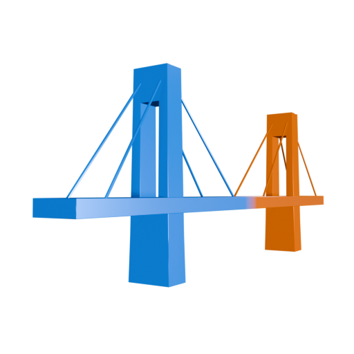
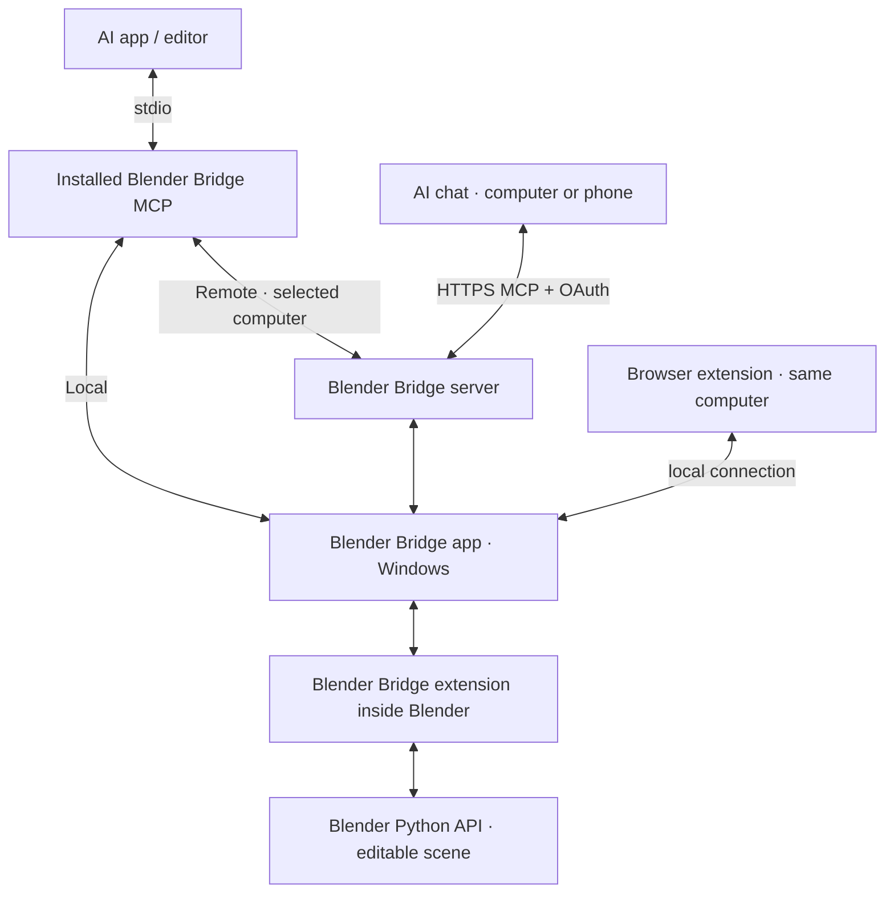

<div align="center">


# Blender Bridge

**Connect AI chats and coding agents to a real, editable Blender scene.**

Model, build node systems, light, animate, render and export through Blender's Python API. Inspect the scene and viewport, refine the work in conversation, and keep the objects, materials and animation in a regular Blender project.

[**Website**](https://blenderbridge.com/) · [**Documentation**](https://blenderbridge.com/#documentation) · [**Download for Windows**](https://github.com/Blender-Bridge/blender-bridge/releases/latest/download/Blender_Bridge_Installer.exe) · [**Chrome Web Store**](https://chromewebstore.google.com/detail/blender-bridge/lgdjpajmggpkjcdogglbeipbkckdpoki) · [**Releases**](https://github.com/Blender-Bridge/blender-bridge/releases)

Windows 10/11 x64 · Blender 4.2+ · Your own AI account or local model
</div>

Blender Bridge combines a Windows Desktop app, an extension inside Blender, MCP tools and a browser extension. It supplies the connection, tools and execution environment. Your chosen AI plans the task and writes Blender Python; Blender performs the work on the receiving computer. You can start with an existing project, create a new scene, or work in an explicitly shared Blender computer through your own AI.

This is the product's documentation and release repository. It hosts Windows downloads and product documentation. **For installation, use `Blender_Bridge_Installer.exe` from Releases; cloning this repository does not install Blender Bridge.** A seven-day trial is available without a card; continued access uses a [Blender Bridge subscription](https://blenderbridge.com/#pricing). AI access is separate.

[Capabilities](#capabilities) · [Connections](#connections) · [Architecture](#architecture) · [MCP interface](#mcp-interface) · [Files and rendering](#files) · [History](#history) · [Setup](#setup) · [Compatibility](#compatibility) · [Troubleshooting](#troubleshooting)

<a id="capabilities"></a>
## What you can do in Blender

The AI works with Blender data and operations in the actual scene. Objects, collections, meshes, node graphs, cameras and keyframes remain available for further work in Blender. You can continue by hand and return to AI-assisted editing in the same project.

| Area | Work you can request | What remains editable |
|---|---|---|
| **Modeling and scene layout** | Build props, products, interiors and level blockouts; use meshes, curves, text, modifiers, booleans and subdivision; adjust dimensions, transforms and collections. | Blender objects, geometry, modifiers and scene structure. |
| **Geometry Nodes** | Build procedural fences, buildings, scattering, arrays or node-based effects; expose the controls that matter, such as spacing, density or floor count. | The node graph and parameters on the modifier. |
| **Materials, textures and UVs** | Build Principled BSDF and shader graphs, procedural materials, UV layouts and texture baking. Search free asset libraries when useful. | Material nodes, UVs and the associated texture files. |
| **Lighting and cameras** | Set studio or natural lighting, HDRIs, camera position, focal length, depth of field, framing and color settings. | Lights, worlds, cameras and render settings. |
| **Animation, rigging and simulation** | Create keyframes, curves, camera moves, armatures, constraints and drivers; configure rigid bodies, cloth, fluids and other Blender simulations. | Animation data, rigs and simulation settings; baked caches are separate files. |
| **Rendering and compositing** | Produce preview or final images, transparent backgrounds, animation and video; use Cycles, EEVEE, Workbench and compositing nodes. Run long renders in a separate Blender process. | The scene, render setup and requested output files. |
| **Photo-reference work** | Put a PNG/JPEG reference behind the scene camera; build the scene with the AI, render it and compare reference and render side by side. | The camera reference and the modeled scene; modeling is performed by your AI. |
| **Import, export and automation** | Prepare assets for game engines, websites, AR or printing; import other Blender-supported formats; batch operations or build custom scene tools through Python. | The source project and the exported files. |

For example, a game-asset workflow can combine modeling, UVs and materials, a viewport check, revisions, then an FBX or GLB export. A product scene can keep the same model and change cameras, lighting and materials for a series of images or an animation. A printing workflow can start from dimensions and finish with an STL checked in a slicer.

The result depends on the AI's coding, image understanding and judgment, the brief and the available hardware. Blender Bridge provides access to Blender's Python API and supporting tools; it does not supply an AI model or a separate neural text-to-mesh engine.

[Capabilities guide](https://blenderbridge.com/#documentation-what-ai-can-do-in-blender) · [Geometry Nodes](https://blenderbridge.com/#documentation-geometry-nodes) · [Materials and assets](https://blenderbridge.com/#documentation-materials) · [Photo references](https://blenderbridge.com/#documentation-scene-from-photo)

<a id="connections"></a>
## Choose the connection for your AI

MCP, the Model Context Protocol, lets an AI host discover and call tools. Blender Bridge offers an installed MCP connection, a hosted HTTPS MCP endpoint, and a browser extension. They reach the same execution environment through different routes.

| Where the AI runs | Connection | Where Blender runs |
|---|---|---|
| **Desktop and IDE clients supporting MCP, including Claude Code, Codex, Cursor and VS Code** | Installed Blender Bridge MCP on Windows, using `stdio` between the host and the MCP process. Its runtime is included. | This Windows computer, or a computer belonging to you or a collaborator selected through Remote mode. |
| **ChatGPT, Claude and hosts with custom HTTPS MCP connections** | `https://mcp.blenderbridge.com/mcp` with OAuth sign-in. Custom connections must be available in the host/account. | The selected Windows computer; the chat may run on another computer or a phone. |
| **Compatible browser AI chats, including ChatGPT, Claude, Gemini and DeepSeek** | [Blender Bridge browser extension](https://chromewebstore.google.com/detail/blender-bridge/lgdjpajmggpkjcdogglbeipbkckdpoki), with universal Auto Setup and the app's pairing key. | The same computer as the browser extension. |

Use MCP when your AI supports it. The browser extension uses universal Auto Setup to adapt to compatible AI chat interfaces, including chats without an MCP connection. Auto Setup finds usable interaction methods for the page's message editor; file/image transfer also requires compatible attachment controls. Run Auto Setup for the chat site and allow the extension access to it. It does not provide a remote route to a different Blender computer.

A **plugin** packages the MCP connection and, in compatible hosts, a Blender panel. It is not another Blender engine. Hosts supporting MCP Apps can show the scene view, history, files and render progress inside the chat. The MCP tools also work in hosts without that panel. Marketplace availability and panel support are determined by the host.

### Remote work and collaboration

Remote work uses your account to select a receiving computer. The Blender Bridge app and Blender run there; a phone or laptop with the chat does not need its own Blender installation. The receiving computer must stay on and connected.

Collaboration applies the same model to another person's computer. One participant **receives commands in Blender** on their computer; the other uses **their own AI** to work there. Either can initiate an invitation, choosing their role for that session. The other participant sees and accepts their role. Both accounts need confirmed email and active Blender Bridge access. Being contacts alone grants no control.

A session joins the owner and one invited person. An invitation has a limited acceptance period; an accepted session continues until either person ends it, subject to account access and computer availability. Use the installed MCP's Remote mode, HTTPS MCP or a compatible plugin for collaboration; the browser extension remains local.

[Remote work](https://blenderbridge.com/#documentation-blender-from-any-device) · [Collaboration](https://blenderbridge.com/#documentation-collaboration)

<a id="architecture"></a>
## Architecture and execution



| Component | Responsibility |
|---|---|
| **AI host and chosen model** | Interpret the task, select tools, write Blender Python, examine returned data/images and plan revisions. |
| **Installed MCP process** | Expose Blender and application tools to desktop and IDE clients supporting MCP. In Local mode it reaches the local app; in Remote mode it routes to a selected own/shared computer. |
| **Blender Bridge app** | Manage account access, the selected Blender installation, project workspace, Blender extension, connection state and command history. This is the common execution point on the receiving computer. |
| **Blender extension** | Execute inside Blender, expose scene information and images, and support scene checkpoints and rendering operations. |
| **Blender Bridge server** | Route remote connections and collaboration to the authorized computer, and provide temporary download links for requested files. Blender modeling and rendering still run on the receiving computer. |
| **Browser extension** | Connect the supported AI web page to the app on the same computer. |

An online chat does not connect to its own device's `localhost` to reach your Blender computer. A remote request travels through the server to the selected app; local MCP and the browser extension connect to the local app. Tool results and requested images return along the chosen route.

<a id="mcp-interface"></a>
## MCP interface: inspect, execute, verify

The connected server supplies the current tool names, schemas and descriptions through MCP. The groups below explain the interface; the current schemas come from `tools/list`, while visual panels depend on the host.

| Task | Main tools |
|---|---|
| Select and check the destination | `get_connection`, `set_connection`, `get_setup_status`, `check_connection`, `get_blender_info` |
| Inspect the project and result | `get_scene_state`, `take_screenshot` |
| Work in Blender | `execute_blender_code` |
| Look up the API and workflows | `lookup_blender_api`, `search_blender_manual`, `get_blender_recipe` |
| Find optional assets | `find_free_assets` |
| Save, render and export | `save_blend_file`, `render_project_image`, `export_model` |
| Use a reference | `set_reference_image`, `compare_reference_render` |
| Retrieve output files | `list_project_files`, `get_project_file` |
| Follow a long operation | `get_blender_operation_status`, `cancel_blender_operation` |
| Recover a scene state | `scene_checkpoints`, `undo_last_action` |
| Configure the receiving app | `get_app_state`, `find_blender_installations`, `select_blender`, `open_blender`, `ensure_blender_extension`, `set_project_workspace` |
| Work with a collaborator | `list_friends`, `invite_collaborator`, `accept_collaboration`, `end_collaboration` |

### A scene-aware working loop

The AI can inspect the existing scene before making changes, execute a named operation, request a viewport or camera image, then refine the result. Images are requested when useful; a screenshot, render or export is not required after every command.

For example, these are MCP `tools/call` parameters for inspecting the scene:

```json
{
  "name": "get_scene_state",
  "arguments": { "full": false }
}
```

An explicit request to keep a project can use the file tool:

```json
{
  "name": "save_blend_file",
  "arguments": {
    "filename": "scene.blend",
    "operation_name": "Save the working scene"
  }
}
```

For Python work, `execute_blender_code` accepts `code` and a short `operation_name` used in the human-readable history. File-producing code also uses structured project/output fields. The server's schemas and `get_llm_instruction` describe those contracts and available helpers.

A long operation may return a **running request ID** before it finishes. Poll that ID with `get_blender_operation_status` instead of submitting the work again. A running acknowledgement is not the completed output. Background renders support stopping; other operations can stop only where that operation supports cancellation.

### Knowledge and optional assets

The AI can consult the Python API reference for the available Blender versions and search the Blender 5.2 manual. Optional recipes cover product shots, interiors, characters, ad clips and photo-reference work. Reading a reference or recipe does not change the scene or force a particular workflow.

`find_free_assets` searches CC0 textures from Poly Haven and ambientCG, plus models and HDRIs from Poly Haven. Search does not download or apply an asset. A selected asset can then be downloaded into Blender Bridge's local asset storage and used in the scene. Materials use the maps available for that asset; opacity or displacement is added when needed and present. The AI names the source. External assets are optional.

<a id="files"></a>
## Projects, rendering and exported files

The **project workspace** is the default folder for requested scenes, renders and exports. Creating or editing a scene does not itself save a `.blend` file. `save_blend_file` saves a copy of the complete scene while preserving the open file and unsaved changes. Keep the source `.blend` when you want to return to objects, nodes or animation after exporting.

### Images, animation and background rendering

`render_project_image` produces PNG images, with dimensions up to 8192 × 8192. The AI can set render engines, lighting, transparency and compositing through Blender Python. For animation or a long render, Blender Bridge can save a scene copy and render it in a **separate Blender process**, report progress and stop that render. The main Blender remains responsive.

The background job renders the scene copy made **at launch time**. Later edits to the open scene belong to another version, not to the running render. Bake simulations into their file caches before rendering a background animation; scene checkpoints do not roll those files back. Request the finished image sequence or video after the operation completes.

### Export presets

| Destination | Output | Export behavior |
|---|---|---|
| **Web and Godot** | GLB | Model/material data in one file, with scene-unit scale accounted for. |
| **Unity** | FBX | Y up, −Z forward; scene scale and embedded textures. |
| **Unreal Engine** | FBX | Z up, −Y forward; scene scale and embedded textures. |
| **AR** | USDZ | Meter-based scene; the preset requires unit scale 1. |
| **3D printing** | STL | Coordinates in millimeters, accounting for scene-unit scale. STL has no unit label or materials; check dimensions and print preparation in the slicer. |

The export tool leaves scene transforms unchanged, refuses an existing destination, and reports axes, units, file size and material warnings. Procedural materials may need texture baking for another application. Open the result in the intended engine, viewer or slicer to check it. Other Blender formats, such as OBJ, PLY, Alembic or USD, remain available through Python.

### Reference images and delivery

A photo can come from a project file, a direct public image link, or a chat attachment when the host can pass files to tools. PNG/JPEG are supported. `set_reference_image` sets the camera reference; your AI builds and adjusts the scene. After rendering, `compare_reference_render` creates a side-by-side image with proportions preserved. Each input image can contain up to 8 megapixels; the comparison is not an automatic camera solver or neural mesh reconstruction.

Files remain on the Blender computer. Local file retrieval returns a disk path; server-connected chats can receive a temporary download link. That signed link is valid for 24 hours **from upload**, and anyone holding it can download without another sign-in. Ending a collaboration session does not revoke a link already issued. Link expiry and physical cleanup of the temporary server copy are separate steps.

[Rendering](https://blenderbridge.com/#documentation-rendering) · [Exporting](https://blenderbridge.com/#documentation-export) · [3D printing](https://blenderbridge.com/#documentation-3d-printing)

<a id="history"></a>
## Checkpoints and scene history

AI work is recorded as named scene steps. Returning to a named step restores the scene **after that step**; `undo_last_action` returns to the state **before the latest AI change**. These are different operations.

A checkpoint covers the whole Blender scene, including later manual edits that may be undone by a return. Manual edits do not become independent AI-history entries. An available **Undo return** restores the preceding scene state until further work invalidates that return. Important results should also be saved as `.blend` files: the available history is bounded by storage and retention.

For an already saved project, returning to a checkpoint also writes the restored scene back to that original `.blend` file; Blender Bridge first keeps backups of the current scene and the existing disk file. Recovery does not undo other output files, exports, simulation caches or external effects. [Checkpoint guide](https://blenderbridge.com/#documentation-checkpoints)

<a id="setup"></a>
## Install and connect

1. Install [Blender 4.2 or later](https://www.blender.org/download/) and the [Windows installer](https://github.com/Blender-Bridge/blender-bridge/releases/latest/download/Blender_Bridge_Installer.exe).
2. Sign in to Blender Bridge. To start the trial, choose **Try for free** and confirm your email; registration alone does not start it. An account with active access can continue immediately.
3. Follow the app's setup: select Blender, choose a project folder and install the Blender Bridge extension in Blender.
4. Open **Settings → Connection methods** and use one route below. Use the same Blender Bridge account for the app and its connection.

**Installed MCP:** copy the setup instruction from the app to your agent, or use the generated configuration in the host's MCP settings. It contains the actual executable, entry point and paths for your installation. The runtime is included; no separate Node.js, Python, npm or uv installation is required. Use the host's own configuration format and reload it if needed. A generic `mcpServers` block is not the format of every client.

**HTTPS MCP:** add `https://mcp.blenderbridge.com/mcp` as a custom connection in the AI host's settings, complete OAuth and select the receiving computer. Pasting the URL into an ordinary chat message does not configure MCP. Custom connectors and administrator approval depend on the host/account/workspace.

**Browser extension:** install from the [Chrome Web Store](https://chromewebstore.google.com/detail/blender-bridge/lgdjpajmggpkjcdogglbeipbkckdpoki), sign in and paste the app's pairing key into its settings. On the AI website run **Auto Setup**. Send **LLM Instruction** in each new conversation, then use **Run** for a command or **Auto** mode. The extension can appear in the chat, as a floating button or in the browser side panel.

Before editing a project, ask the AI to identify the selected computer and Blender version, inspect the scene and show its viewport. This can use `get_connection`, `get_setup_status`, `get_blender_info`, `get_scene_state` and `take_screenshot`; no test object or project overwrite is necessary.

[Installation](https://blenderbridge.com/#documentation-install) · [MCP setup](https://blenderbridge.com/#documentation-mcp-server) · [ChatGPT/Claude](https://blenderbridge.com/#documentation-plugin) · [Browser extension](https://blenderbridge.com/#documentation-browser-extension)

<a id="compatibility"></a>
## Compatibility, access and execution boundaries

| Requirement | Details |
|---|---|
| **Receiving computer** | Windows 10/11 x64, Blender 4.2+ and the Blender Bridge app. Desktop versions for macOS and Linux are planned — coming soon. |
| **Remote HTTPS chat/client** | Any device running a compatible host. It can control an authorized Windows receiver without its own Blender installation. |
| **Browser extension** | Chrome, Microsoft Edge or another compatible Chromium browser on the Blender computer. Universal Auto Setup connects compatible AI chat interfaces, using the browser extension APIs and the site's message/file controls. |
| **AI** | Your own account or local model. Coding ability and image understanding affect the work; custom MCP and panel availability depend on the host. |
| **Languages** | App interface and documentation in 15 languages. |
| **Trial and subscription** | Seven days once, explicitly activated with confirmed email; no card or automatic paid conversion. Continued access: 1, 3, 6 or 12 months. [Current plans](https://blenderbridge.com/#pricing). |

Blender Python runs with the Blender process's privileges. Account authorization and pairing protect the connection; they do not turn arbitrary Python into an operating-system sandbox. Use the approval controls of your AI host and consider the effects of code on the project and computer.

The Blender-side connection listens on loopback. Remote commands and necessary results travel through the Blender Bridge server; usage statistics exclude AI conversations, code, scenes, images and file names. See [security and privacy](https://blenderbridge.com/#documentation-security) and the [privacy policy](https://blenderbridge.com/privacy).

The app manages signed-release updates for itself, Blender Bridge MCP and the Blender extension. The browser extension updates through the Chrome Web Store. Subscription expiry does not delete saved projects; those files remain usable in Blender.

<a id="troubleshooting"></a>
## Troubleshooting

| What you observe | What to check |
|---|---|
| **No Blender tools in the AI host** | Register/reconnect MCP in host settings. For the browser extension, complete Auto Setup and send the LLM instruction in that conversation. |
| **Tools appear, but Blender is unavailable** | Read the setup/connection result: account access, selected computer, app availability and Blender extension readiness are separate checks. |
| **Installed MCP cannot start** | Recopy the instruction/configuration from the app so the executable and entry-point paths match the installation. |
| **The wrong computer is selected** | Read `get_connection`, select a listed destination with `set_connection`, and confirm the route before another change. |
| **A remote computer is offline** | Keep its app and Blender running and connected. A local browser extension cannot reach another machine. |
| **A long operation is still running** | Poll its request ID; do not submit a duplicate. Use the stop operation only where supported. |
| **An exported asset looks different elsewhere** | Check units, axes and the material warnings. Procedural shaders may need baking; inspect the file in the target application. |

[Full troubleshooting guide](https://blenderbridge.com/#documentation-troubleshooting) · [Choose an AI](https://blenderbridge.com/#documentation-which-ai-to-use)

## Releases, support and license

[Releases](https://github.com/Blender-Bridge/blender-bridge/releases) provide the installer, release notes and updater assets. **New installations start with `Blender_Bridge_Installer.exe`.** `SHA256SUMS.txt` lists file checksums; the updater uses signed release metadata.

For questions, bug reports or a suspected security issue: [support@blenderbridge.com](mailto:support@blenderbridge.com). Include product/Blender/AI-host versions, connection method and the relevant redacted error; exclude credentials and private project content.

Blender Bridge is a commercial product. See [LICENSE](LICENSE) and the [terms](https://blenderbridge.com/terms). This repository does not offer the application source code under an open-source license.

Blender Bridge is an independent product, not affiliated with, endorsed by or sponsored by the Blender Foundation. Blender is a registered trademark of the Blender Foundation.
